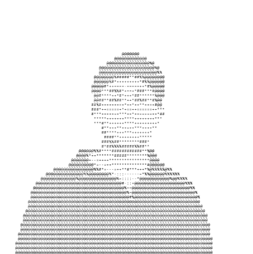

<!-- ===================== HEADER ===================== -->

<table>
<tr>
<td width="40%" align="center">

</td>
<td width="60%">

<pre>
shrey@mehta ─────────────────────────────────────

• Education: ........ Electrical Engineering @ McMaster University
• Current: .......... Biomechanics Research Fellow @ RadioSyn
• Prev: ............. Developer Intern @ Tata Consultancy Services
• Team: ............. McMaster Mars Rover Team
• Focus: ............ Embedded Systems & Robotics

- Interests ──────────────────────────────────────

• Robotics
• Embedded Systems
• Autonomous Systems
• Electronics
</pre>

</td>
</tr>
</table>

 

<!-- ===================== ABOUT ===================== -->

## 📌 About Me

I'm **Shrey**, an Electrical Engineering student at **McMaster University**. I enjoy building systems that combine electronics, embedded software, and robotics, from initial circuit design and CAD to sensors, microcontrollers, and working prototypes.

I've worked across **robotics research, autonomous systems, and software development**, including a developer internship at **Tata Consultancy Services (TCS)**, biomechanics research at **RadioSyn**, and engineering work with the **McMaster Mars Rover Team**.

<!-- ===================== TECH ===================== -->

## 🛠️ Tools & Tech

- ⚡ **Electrical & Embedded:** PCB Design, ESP32, STM32, FPGA, Verilog, Arduino, Sensors, CAN, I2C, SPI, UART, Oscilloscope, Multimeter, Microcontroller, Soldering & Wiring
- 💻 **Programming:** Python, Java, C/C++, SQL, Linux, Git, REST APIs, CI/CD
- 🧰 **Engineering Tools:** KiCad, Altium, Cadence, SolidWorks, Autodesk Inventor, AutoCAD, Revit, MATLAB, Azure DevOps, Microsoft Azure, Microsoft Office, Microsoft Excel

<!-- ===================== PROJECTS ===================== -->

## 🚀 Featured Projects

### 🤖 VendiGo

An autonomous mobile storefront built at **Hack the North 2026**, combining autonomous navigation, embedded hardware, voice interaction, and real-time inventory management.

### 🛰️ McMaster Mars Rover

Designed and manufactured hardware for McMaster's competitive Mars rover, including its electrical enclosure and integration of **15+ electrical subsystems**.

### 🔬 Robotics Research

Worked on robotics, computer vision, automation, and biomedical engineering applications through research at **McMaster University** and the **University of Toronto**.

<!-- ===================== CONTACT ===================== -->

## 🔗 Connect with Me

&nbsp;&nbsp;&nbsp;

&nbsp;&nbsp;&nbsp;

