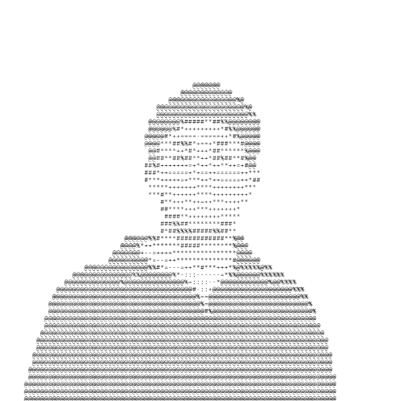

<!-- ===================== HEADER ===================== -->

<table>
<tr>
<td width="40%" align="center">

</td>
<td width="60%">

<pre>
shrey@mehta ─────────────────────────────────

Education  .... Electrical Engineering @ McMaster
Current    .... Electronics Research @ RadioSyn
Team       .... Electrical @ McMaster Mars Rover
Prev       .... TCS, teaBOT

Focus      .... Hardware & Embedded Systems
Interests  .... Electronics, PCB, Robotics
</pre>

</td>
</tr>
</table>

 

<!-- ===================== ABOUT ===================== -->

## About Me

**building things that should exist.**

Electrical Engineering @ McMaster University. Currently working on electronics research at RadioSyn and rover hardware at the McMaster Mars Rover Team.

Interested in circuit design, embedded systems, digital hardware and robotics.

<!-- ===================== TECH ===================== -->

## Tools & Technologies

- **Electrical & Hardware:** PCB Design, Altium Designer, KiCad, PSpice, Circuit Debugging, Oscilloscope, Digital Multimeter, Soldering & Wiring
- **Embedded & Digital Systems:** STM32, ESP32, FPGA, Verilog, Quartus Prime, Arduino, UART, I2C, SPI, PWM
- **Programming:** C/C++, Python, Java, SQL, Linux, Git, Angular, REST APIs
- **Engineering Tools:** MATLAB, SolidWorks, Autodesk Inventor, Azure DevOps, Microsoft Azure

<!-- ===================== PROJECTS ===================== -->

## Featured Work

### VendiGo | Autonomous Mobile Storefront

Built at Hack the North 2026, integrating STM32-based PWM motor control, ESP32, Raspberry Pi Zero, autonomous navigation and voice interaction.

**Top 32 out of 350 teams.**

`STM32` `ESP32` `Raspberry Pi` `PWM` `Embedded Systems`

### McMaster Mars Rover | Electrical Systems

Designed custom PCBs in Altium Designer, including an STM32-controlled power distribution board. Worked on a 48 V, 40 A battery distribution system with high-side MOSFET protection and onboard electrical integration.

`Altium Designer` `STM32` `PSpice` `PCB Design` `Power Distribution`

### RadioSyn | Electronics Research

Working on control electronics for radiopharmaceutical processing, including PCB assembly, circuit simulation, hardware debugging and FPGA interface development.

`FPGA` `Verilog` `Quartus Prime` `PSpice` `I2C` `SPI`

### teaBOT | Electrical Hardware Validation

Validated electrical hardware across 83 water-heater units, measuring current draw, resistance and thermal performance. Designed moisture-protection systems for heater electronics, reducing water-related failures by 96%.

`Hardware Validation` `Circuit Testing` `Electronics` `Reliability Testing`

<!-- ===================== CONTACT ===================== -->

## Connect

&nbsp;&nbsp;&nbsp;

&nbsp;&nbsp;&nbsp;

